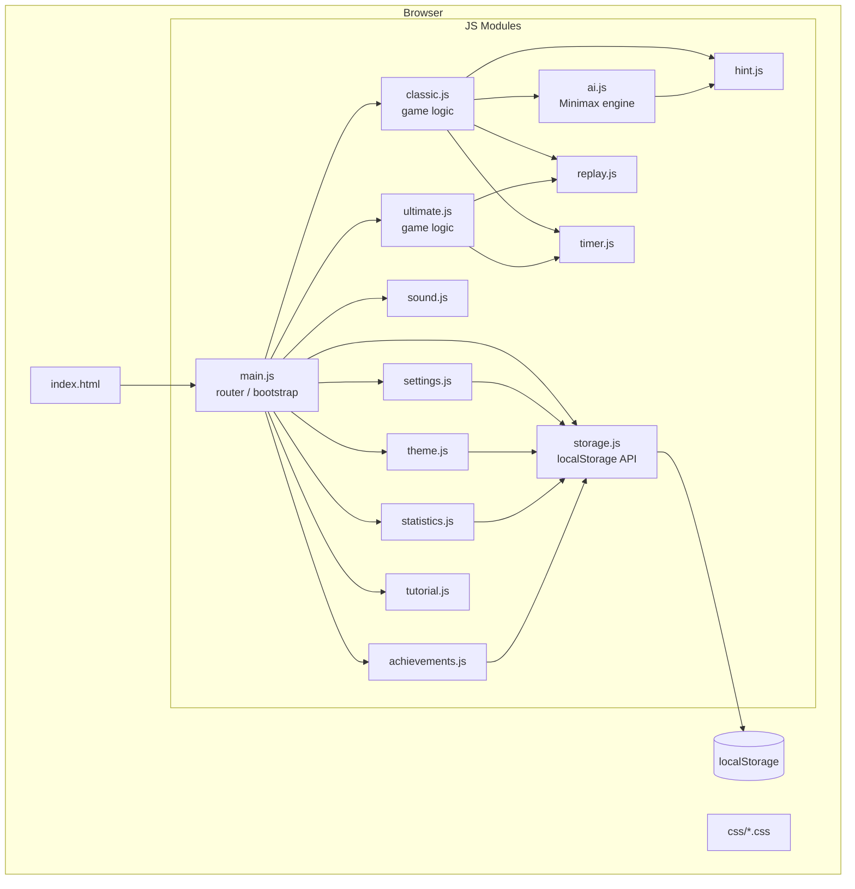

# Design Document — SuperXO

## Overview

SuperXO is a single-page web application (HTML + CSS + vanilla JavaScript) delivering premium Classic and Ultimate Tic-Tac-Toe. There is no build step, no framework, and no server dependency — every feature runs entirely in the browser using ES Modules and localStorage. The architecture is a hub-and-spoke screen router where `main.js` owns navigation state and each feature module owns its own logic, DOM manipulation, and events. The visual language is glassmorphism on a dark radial-gradient background with neon blue/green accent glows, consistent rounded-corner cards, and CSS custom-property-driven theming.

---

## Architecture



### Navigation Model

`main.js` maintains a `currentScreen` string and a screen history stack. Every screen is a `<div class="screen">` in the DOM; exactly one is visible at a time. The `navigate(screenId, options)` function hides the current screen, shows the target, and plays a CSS transition. The back stack enables `navigateBack()` without page reloads.

```
Splash → Home → Game_Select → Classic_Setup → Classic_Game
                             → Ultimate_Setup → Ultimate_Game
              → Statistics
              → Achievements
              → Tutorial → Classic_Tutorial
                         → Ultimate_Tutorial
              → Settings
              → About
```

---

## Components and Interfaces

### storage.js

The sole module that touches `localStorage`. All other modules call `Storage.get` / `Storage.set`.

```js
// Public API
Storage.get(key)          // returns parsed value or default
Storage.set(key, value)   // JSON-serialises and writes
Storage.clear()           // wipes all SuperXO keys
Storage.DEFAULTS          // object mapping every key to its default value
```

Keys and defaults:

| Key | Default |
|-----|---------|
| `splashSeen` | `false` |
| `settings` | `{ darkMode: true, animations: true, sound: true, music: true, timerDefault: false, timerDuration: 30 }` |
| `theme` | `"classic"` |
| `boardCustom` | `{ gridStyle: "solid", borderStyle: "rounded", cornerRadius: 18, glowIntensity: "medium", winLineStyle: "glow" }` |
| `pieceColors` | `{ x: "#2dd4ff", o: "#7dff74" }` |
| `unlockedThemes` | `["classic"]` |
| `unlockedColorPacks` | `[]` |
| `coins` | `0` |
| `statistics` | `{ played: 0, wins: 0, losses: 0, draws: 0, streak: 0, bestStreak: 0, aiWins: 0, aiLosses: 0, favoriteMode: null, totalDuration: 0, history: [] }` |
| `achievements` | `{}` (map of id → `{ unlockedAt: ISO string }`) |

---

### main.js

Bootstrap and router.

```js
// Screen management
navigate(screenId, direction?)  // 'forward' | 'back', default 'forward'
navigateBack()

// Lifecycle
initApp()   // called on DOMContentLoaded; reads storage, applies theme/settings, decides splash vs home
showSplash()
skipSplash()
```

Splash logic:
- If `Storage.get('splashSeen') === false`: run animated splash, set `splashSeen = true` on continue.
- Else: skip directly to Home.

---

### theme.js

```js
Theme.apply(themeName)       // sets CSS custom properties on :root
Theme.getCurrent()           // returns current theme name
Theme.getAll()               // returns array of all theme definitions
Theme.isUnlocked(themeName)  // checks Storage
Theme.unlock(themeName)      // writes to Storage

// CSS custom properties set by each theme:
// --color-bg-1, --color-bg-2, --color-accent-1, --color-accent-2,
// --color-surface, --color-border, --color-text, --glow-color,
// --font-primary
```

Ten themes with color palettes:

| Theme | Accent 1 | Accent 2 | Unlock |
|-------|----------|----------|--------|
| Classic | `#2dd4ff` | `#7dff74` | Free |
| Neon | `#ff00ff` | `#00ffff` | 2 games |
| Royal | `#c0a060` | `#8060e0` | 5 games |
| Glass | `#ffffff` | `#c0e0ff` | 10 games |
| Cyber | `#ff6600` | `#00ffaa` | 15 games |
| Nature | `#44cc44` | `#88dd00` | 20 games |
| Minimal | `#cccccc` | `#888888` | 25 games |
| Midnight | `#4466ff` | `#8844ff` | 50 games |
| Retro | `#ff8800` | `#ffdd00` | 75 games |
| Future | `#00ffff` | `#ff00aa` | 100 games |

---

### settings.js

```js
Settings.get(key)            // reads from Storage.get('settings')[key]
Settings.set(key, value)     // merges into stored settings object
Settings.applyAll()          // applies dark/light class, sound state, animation class
```

---

### sound.js

```js
Sound.play(name)   // names: 'place', 'win', 'draw', 'click', 'unlock', 'error'
Sound.toggle()
Sound.setEnabled(bool)
```

Audio is generated via the Web Audio API (no external files required, keeping asset size minimal). Each sound is a short synthesised tone.

---

### timer.js

```js
Timer.start(duration, onTick, onExpire)  // duration in seconds
Timer.stop()
Timer.reset(duration)
Timer.getRemaining()  // seconds remaining
```

The Timer module owns no DOM; callers pass `onTick(remaining)` to update their UI.

---

### ai.js

```js
AI.getBestMove(board, difficulty)
// board: array[9] of 'X' | 'O' | null
// difficulty: 'beginner' | 'easy' | 'medium' | 'hard' | 'impossible'
// returns: index 0-8

AI.minimax(board, isMaximizing, alpha, beta, depth)  // internal
AI.score(board, player)                               // internal
```

Difficulty mapping:

| Difficulty | Strategy |
|------------|----------|
| Beginner | 80% random |
| Easy | 50% random, 50% minimax depth-2 |
| Medium | 30% random, 70% minimax depth-4 |
| Hard | 10% random, 90% minimax full |
| Impossible | 100% minimax full (Alpha-Beta) |

---

### hint.js

```js
Hint.request(board, player, remaining)
// returns: { index: number, remaining: number }
// remaining: hints left this game (max 3)
// throws HintExhaustedError if remaining === 0
```

Delegates to `AI.getBestMove(board, 'impossible')`.

---

### classic.js

Owns the Classic game state and DOM for the `#classicGame` screen.

```js
// State object
ClassicState = {
  board: Array(9),           // 'X' | 'O' | null
  currentPlayer: 'X' | 'O',
  gameOver: boolean,
  scores: { X: 0, O: 0, draw: 0 },
  round: number,
  totalRounds: number,
  moveHistory: Move[],       // { player, index, timestamp }
  hintsRemaining: number,    // 3
  undoAvailable: boolean,
  startTime: Date,
  mode: 'hvh' | 'hvai',
  difficulty: string,
  players: { X: string, O: string },
  timerEnabled: boolean,
  timerDuration: number,
}

// Public functions
Classic.init(config)         // config from setup form
Classic.handleCellClick(idx)
Classic.undo()
Classic.requestHint()
Classic.restart()
Classic.endGame()            // persists to Statistics
```

Win detection runs after every move against `WIN_PATTERNS` (8 patterns). On win, `Classic.animateWin(pattern)` adds a `winner` CSS class to winning cells and draws an SVG line overlay.

---

### ultimate.js

```js
UltimateState = {
  boards: Array(9),          // each: Array(9) of 'X'|'O'|null
  boardWinners: Array(9),    // 'X' | 'O' | 'draw' | null
  globalBoard: Array(9),     // mirrors boardWinners for global win check
  activeBoard: number | null, // null = any board
  currentPlayer: 'X' | 'O',
  gameOver: boolean,
  moveHistory: UltimateMove[], // { player, localBoard, cell, timestamp }
  startTime: Date,
  mode: 'hvh' | 'hvai',
}

Ultimate.init(config)
Ultimate.handleCellClick(boardIdx, cellIdx)
Ultimate.getActiveBoardHint()
Ultimate.endGame()
```

Active board routing:
- After a move in cell `c` of any local board → `activeBoard = c`.
- If `boardWinners[c] !== null` → `activeBoard = null` (free choice).

---

### replay.js

```js
Replay.load(moveHistory, mode)  // 'classic' | 'ultimate'
Replay.stepForward()
Replay.stepBack()
Replay.getCurrentStep()         // returns { step, total, boardState, player, moveIdx }
Replay.reset()
```

Replay reconstructs board state by replaying moves from index 0 up to the current step. It does not mutate live game state.

---

### statistics.js

```js
Statistics.record(result)
// result: { mode, winner, duration, vsAI, difficulty, moveCount }

Statistics.get()         // returns full stats object from Storage
Statistics.reset()       // clears stats with confirmation dialog
Statistics.renderGraph() // draws win/loss/draw bar chart on canvas
```

---

### achievements.js

Achievement definitions:

| ID | Name | Condition | Coins |
|----|------|-----------|-------|
| `first_win` | First Win | wins >= 1 | 50 |
| `wins_5` | 5 Wins | wins >= 5 | 100 |
| `wins_10` | 10 Wins | wins >= 10 | 150 |
| `wins_25` | 25 Wins | wins >= 25 | 200 |
| `wins_50` | 50 Wins | wins >= 50 | 300 |
| `wins_100` | 100 Wins | wins >= 100 | 500 |
| `perfect_game` | Perfect Game | win with 0 opponent moves scoring | 200 |
| `beat_impossible` | Beat Impossible AI | win vs AI on Impossible | 500 |
| `marathon` | Marathon Player | played >= 50 | 250 |

```js
Achievements.check(stats)     // evaluates all conditions, unlocks new ones
Achievements.unlock(id)       // persists, awards coins, shows toast
Achievements.getAll()         // returns array with unlock status + progress %
Achievements.isUnlocked(id)   // boolean
```

---

### tutorial.js

```js
Tutorial.startClassic()
Tutorial.startUltimate()
Tutorial.nextStep()
Tutorial.prevStep()
Tutorial.enterPractice()
Tutorial.exit()
```

Tutorial steps are data-driven arrays of `{ instruction, highlightSelector, waitForAction, actionValidator }`. On each step, the tutorial overlay highlights the `highlightSelector` element and only advances when `actionValidator(event)` returns true.

---

## Data Models

### Move (Classic)
```js
{
  player: 'X' | 'O',
  index: number,        // 0–8
  timestamp: number,    // ms since game start
}
```

### UltimateMove
```js
{
  player: 'X' | 'O',
  localBoard: number,   // 0–8
  cell: number,         // 0–8
  timestamp: number,
}
```

### GameResult
```js
{
  mode: 'classic' | 'ultimate',
  winner: 'X' | 'O' | 'draw',
  players: { X: string, O: string },
  duration: number,     // seconds
  vsAI: boolean,
  difficulty: string | null,
  moveCount: number,
  date: string,         // ISO 8601
}
```

### AchievementRecord
```js
{
  id: string,
  name: string,
  description: string,
  coinReward: number,
  condition: (stats) => boolean,
  progress: (stats) => number,   // 0–1
}
```

### ThemeDefinition
```js
{
  id: string,
  name: string,
  unlockGames: number,
  vars: { [cssVar]: string },
}
```

---

## Correctness Properties

*A property is a characteristic or behavior that should hold true across all valid executions of a system — essentially, a formal statement about what the system should do. Properties serve as the bridge between human-readable specifications and machine-verifiable correctness guarantees.*

### Property-Based Testing Overview

Property-based testing (PBT) validates software correctness by testing universal properties across many generated inputs. Each property is a formal specification that should hold for all valid inputs.

The PBT library used is **fast-check** (imported via CDN in the test harness). Each property test runs a minimum of **100 iterations**.

Tag format used in test files: `// Feature: superxo, Property N: <property_text>`

---

### Property 1: Classic win detection is exhaustive and symmetric

*For any* 3×3 board state where one player occupies all three cells of any win pattern, `checkWinner(board)` SHALL return that player as the winner, regardless of which player or which pattern.

**Validates: Requirements 5.4**

---

### Property 2: Classic draw detection is correct

*For any* fully-filled 3×3 board with no winning pattern, `checkWinner(board)` SHALL return `'draw'`.

**Validates: Requirements 5.5**

---

### Property 3: Move history replay round-trip

*For any* sequence of valid Classic moves, replaying that sequence from an empty board SHALL produce a board state identical to the board state after the original sequence was played live.

**Validates: Requirements 8.2, 8.3**

---

### Property 4: AI move is always valid

*For any* non-terminal Classic board state (at least one empty cell, no winner), `AI.getBestMove(board, difficulty)` SHALL return an index in 0–8 that is currently empty on the board, for all five difficulty levels.

**Validates: Requirements 6.1, 6.2, 6.3**

---

### Property 5: Impossible AI never loses

*For any* board state where the AI plays as 'O' from the opening move using Impossible difficulty, the final outcome SHALL be either a draw or an AI win — never a human win.

**Validates: Requirements 6.3**

---

### Property 6: Storage round-trip

*For any* serialisable value written with `Storage.set(key, value)`, reading it back with `Storage.get(key)` SHALL return a value deeply equal to the original.

**Validates: Requirements 17.1, 17.2**

---

### Property 7: Achievement unlock idempotence

*For any* stats object that already satisfies an Achievement condition, calling `Achievements.check(stats)` multiple times SHALL not increase the Coin balance or fire the toast more than once per Achievement.

**Validates: Requirements 11.4**

---

### Property 8: Coin balance never goes negative

*For any* sequence of purchase and earn operations, `Storage.get('coins')` SHALL never be less than 0.

**Validates: Requirements 12.5, 12.6**

---

### Property 9: Ultimate active-board routing

*For any* Ultimate move in cell `c` of local board `b`, if `boardWinners[c]` is null (board `c` is still open), the `activeBoard` SHALL be set to `c` after the move.

**Validates: Requirements 7.2**

---

### Property 10: Theme CSS variables are always set after apply

*For any* valid theme name passed to `Theme.apply(themeName)`, all required CSS custom properties (`--color-bg-1`, `--color-accent-1`, `--color-accent-2`, `--color-surface`, `--color-text`, `--glow-color`) SHALL be non-empty strings on the `:root` element afterward.

**Validates: Requirements 13.2**

---

## Error Handling

| Scenario | Handler |
|----------|---------|
| `localStorage` unavailable or full | `Storage.set` catches the exception, logs a warning, and returns without throwing; UI continues with in-memory values |
| AI `getBestMove` called on a terminal board | Returns `null`; callers guard with `if (move !== null)` |
| `Hint.request` called with 0 remaining | Throws `HintExhaustedError`; `classic.js` catches and shows a Dialog |
| Timer fires on a game-over board | `Timer.stop()` is always called in `Classic.endGame()`; orphaned callbacks check `gameOver` flag |
| Corrupted Storage JSON | `Storage.get` wraps `JSON.parse` in try/catch and returns the default value |
| Unknown theme name passed to `Theme.apply` | Falls back to `"classic"` theme and logs a warning |

---

## Testing Strategy

### Unit Tests

Unit tests live in `tests/unit/` and cover:
- `checkWinner` with specific known board states (all 8 win patterns, full-draw board, incomplete board)
- `AI.getBestMove` for each difficulty on a set of known board positions
- `Storage.get` returning defaults for missing/corrupted keys
- `Achievements.check` with crafted stats objects triggering each achievement
- `Timer` tick/expire callbacks
- `Replay` step-forward and step-back on a known move sequence

### Property-Based Tests

Property tests live in `tests/property/` and use **fast-check**.

Each test is tagged with `// Feature: superxo, Property N: <text>` and runs ≥ 100 iterations.

Properties 1–10 listed above are each implemented as a single `fc.assert(fc.property(...))` call.

Generators:
- `arbitraryBoard()` — random array[9] of `'X' | 'O' | null` with realistic fill ratios
- `arbitraryWinningBoard(player)` — board where `player` occupies one full win pattern
- `arbitraryFullDrawBoard()` — fully filled board with no winner (generated by rejection sampling)
- `arbitraryMoveSequence()` — valid sequence of alternating X/O moves on an initially empty board
- `arbitrarySerializableValue()` — numbers, strings, arrays, nested objects
- `arbitraryStatsObject()` — stats with random win/loss/draw/played counts

### Dual Coverage Note

Unit tests catch concrete regressions on specific inputs; property tests verify universal correctness across the full input space. Both are required. Property tests are not a substitute for unit tests on edge cases (e.g., the empty board, the board with one cell left).
